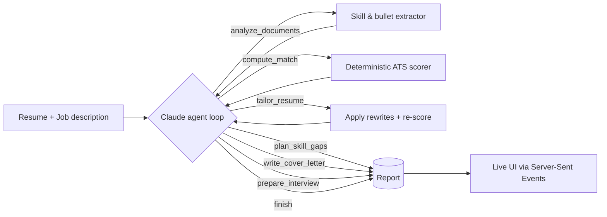

# HireMind: AI Job Application Agent

HireMind is an AI agent that turns **one resume and one job description** into a complete, tailored job application. It works through the task in steps that you can watch live:

1. **Analyses** both documents (skills, experience, resume bullets)
2. **Scores the fit**: an ATS-style match score from a deterministic engine, so the numbers are computed rather than guessed by the model
3. **Tailors the resume**: a new summary and rewritten bullets, then **re-scores** the resume so you can see whether the changes helped
4. **Plans skill gaps**: a prioritised 1–2 week learning plan per missing skill, with free resources
5. **Writes the cover letter**, linking real achievements to the job's requirements
6. **Preps the interview**: likely technical, behavioural and gap-probing questions with personalised tips
7. **Gives a verdict**: *Apply now*, *Apply after upskilling* or *Not a fit yet*, with next steps

Everything can be downloaded as a single Markdown report.

## Why it's an agent, not a single prompt

HireMind runs a real **tool-use loop** on Claude (`claude-opus-5-5`). The model gets seven tools and decides which one to call next. Our code runs each tool and sends the result back, and every step streams to the UI as it happens.



Key design choices:

- **Grounded numbers.** The match score comes from `src/analysis.js`: a 60+ skill lexicon with aliases, mention-weighted coverage, and ATS keyword coverage that ignores proper nouns. The model reasons about these numbers but never invents them.
- **Self-checking.** `tailor_resume` returns the new score, so the agent can see whether its rewrites actually helped and adjust.
- **Truthfulness guardrails.** The system prompt and tool descriptions forbid inventing employers, tools or metrics. Tool inputs are validated, and an invalid call returns an error the agent can recover from.
- **Robust loop.** Handles `pause_turn`, `max_tokens` with truncated tool input, refusals (with server-side model fallback), and a turn cap.
- **Always demoable.** With no API key, a built-in **demo agent** drives the *same tools in the same order*, using rules and templates, so the app works offline or on stage.

## Tech stack

- **Backend:** Node.js 20+ (no framework, built-in `http`), Anthropic TypeScript/JavaScript SDK
- **Agent:** Claude tool use (manual agent loop), streamed to the browser with Server-Sent Events
- **Frontend:** Vanilla HTML/CSS/JS (no build step), animated score ring, live agent trace, tabbed deliverables
- **Tests:** `node:test`: scoring engine, input validation, re-scoring, and an end-to-end agent run

## Run it

```bash
git clone https://github.com/SohamJuneja/hiremind.git
cd hiremind
npm install
npm start            # http://localhost:3000
```

For the live Claude agent, add an API key (otherwise it runs in demo mode):

```bash
cp .env.example .env     # then set ANTHROPIC_API_KEY=sk-ant-...
npm start
```

Click **Try a sample** to load a sample resume and job description, then **Run the agent**.

```bash
npm test             # 9 tests
```

## Project structure

```
server.js            HTTP server, static files, /api/run (SSE) and /api/health
src/agent.js         Claude agent loop (tool use, fallbacks, error handling)
src/demoAgent.js     Offline agent: same tools, template-based writing
src/tools.js         Tool schemas, validation, execution, trace summaries
src/analysis.js      Deterministic engine: skills, keywords, match score, bullets
public/              UI (index.html, styles.css, app.js, samples.js)
test/                Unit and end-to-end tests
```

## Possible extensions

- PDF/DOCX resume upload
- Pull live job listings and rank them by match score
- Track multiple applications over time
- Export the tailored resume as a formatted PDF

## License

MIT
